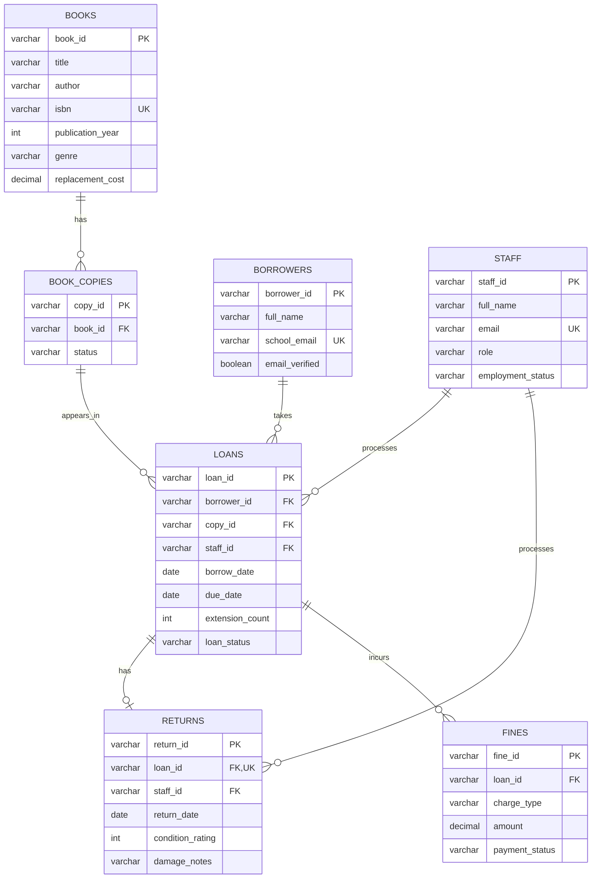

# Portfolio 1 — Library Management Database Design

**Project:** Advanced Database Portfolio  
**Stage:** Portfolio 1 — logical design (SQL implementation and tests pending)  
**Date:** 8 October 2026

This folder documents a seven-entity relational model for a school library management system. The design includes books, physical copies, borrowers, loans, returns, fines and staff, along with circulation rules and staff authorization.

## Files
- `database-design-report.docx` — full design report
- `erd.mmd` — editable Mermaid entity-relationship diagram

## View the ERD

## Scope
Designed: data dictionary, cardinalities, constraints, circulation and fine policies.  
Not yet implemented or tested: SQL DDL, automatic reminders, role-based enforcement, replacement processing, renewal approval, payment processing.

## Next steps
1. Review and approve the logical design.
2. Implement SQL schema and constraints.
3. Add representative seed data and queries.
4. Test borrowing, returns, overdue restrictions, fines, and permissions.
