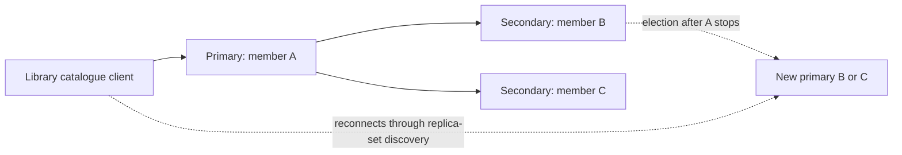

# Portfolio 5: Distributed and Cloud Database Exercise

## Scope and reproduction

Run `npm run portfolio:5` after `npm run setup:mongo`. The runner creates **three actual MongoDB 8.0.17 processes** using WiredTiger, separate data directories and loopback ports, with replica-set name `libraryRs`. It reuses Portfolio 4's catalogue and stops only processes it created. No cloud account, paid resource or external database is involved.

The initial plan proposed PostgreSQL primary/standby replication. The implemented exercise uses MongoDB replication to extend the already-tested NoSQL component and demonstrate automatic election with three voting members. This is an intentional scope decision, not a claim that PostgreSQL replication was configured.

## Actual experiment and evidence

1. Start three members and wait for one primary and two secondaries.
2. Seed the catalogue; update a marker using `w: 'majority'`, journal acknowledgement and a bounded write timeout.
3. Connect directly to each member and poll until all three contain the marker. Majority acknowledgement alone does not imply every secondary has already applied the write; this extra check verifies propagation.
4. Stop the original primary process. This is a controlled process outage, not a network partition or abrupt machine crash.
5. Observe a different primary elected automatically. In the saved run, recovery was observed after **1,609 ms**, measured from before the process-stop call until a new writable primary was observed. The configured election timeout is 3,000 ms; this single controlled result is not a general recovery SLA.
6. Perform another majority-confirmed update and majority read successfully with the original primary still down.

See [replication-results.json](evidence/replication-results.json) for timestamps, members, status, documents and assertions; [transcript.txt](evidence/transcript.txt) for the event sequence; [run.mjs](run.mjs) for execution; and [mongo-runtime.mjs](../tools/mongo-runtime.mjs) for the complete configuration.

## Availability and consistency

Three voting, data-bearing members allow a majority of two to remain after one failure. During election, writes may be unavailable until a new primary is ready. With only one of these three members reachable, a majority cannot be formed; writes requiring majority acknowledgement cannot safely continue. The test exercises one stopped member, not the two-failure scenario.

Replication is asynchronous between members. Secondary reads can lag. Majority write concern gives stronger acknowledgement than a single-node write, but is not the same as instantly updating every replica. Majority read concern reads majority-committed data; it does not by itself promise the latest globally visible value or linearizability. Applications needing read-your-writes across routing changes should design sessions/causal consistency and read preferences deliberately.

The client connects using the replica-set topology and supports retryable writes. Real applications still need timeouts, retry limits and idempotent business operations; retries are not a substitute for avoiding duplicate loan/fine creation.

## Proposed cloud deployment and sharding

For a real deployment, use a managed replica set across separate availability zones, private networking, TLS, individual least-privilege users, secret management, monitoring, backups and tested restore procedures. This prototype uses no authentication because it is short-lived and loopback-only; never expose this configuration to an external network. Replication does not replace backups because accidental changes can replicate too.

Sharding was **not implemented**. If catalogue volume later justified it, a hashed title identifier could spread point lookups, but genre searches might become scatter/gather queries. A branch-based shard key could localise branch operations while risking hot shards at busy branches and cross-shard work for transfers. Choosing a key requires measured workload and cardinality; a small library should not adopt sharding just to add complexity.

All three processes ran on one computer. A host, disk or power failure would affect all members, so this is not evidence of geographic resilience, a cloud deployment, backup restoration or production high availability.

References: [replica-set elections](https://www.mongodb.com/docs/manual/core/replica-set-elections/), [write concern](https://www.mongodb.com/docs/manual/reference/write-concern/), [read concern](https://www.mongodb.com/docs/manual/reference/read-concern/), [sharding](https://www.mongodb.com/docs/manual/sharding/).
